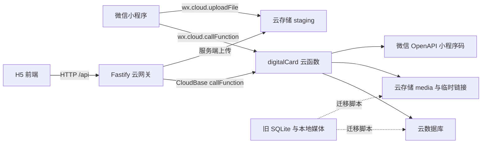
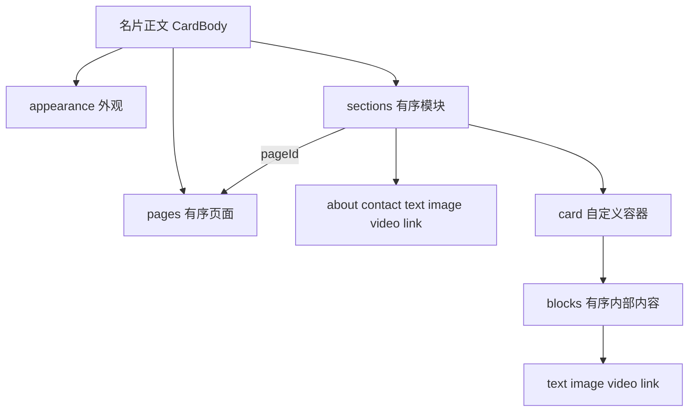
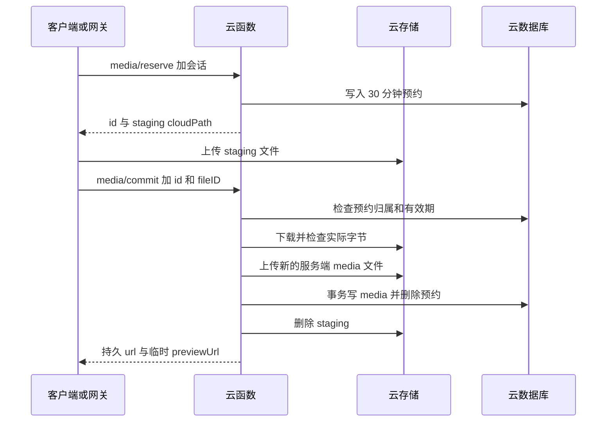

# 一面数字名片代码设计

实现基线：2026-10-11 当前工作区。面向项目开发、维护与交接人员。

一面是一套个人商务数字名片应用，主要交付微信小程序和 H5。名片既包含基本资料，也包含可编排的多页图文、媒体和自定义 Card。正式业务统一运行在微信云函数 `digitalCard` 中：小程序直接调用云函数，H5 经 Fastify 网关转发；账号、名片、收藏、浏览统计和留言保存在云数据库，上传媒体保存在云存储。

仓库保留的 SQLite 后端服务于历史接口回归和数据迁移。理解或修改正式业务时，应以云函数、前端类型和运行入口为准。API 字段约束的最终依据是 [schema.mjs](../cloudfunctions/digitalCard/schema.mjs)，接口清单与部署操作另见 [API.md](API.md) 和 [CloudDevelopment.md](CloudDevelopment.md)。旧说明中的“最多 8 个模块”和仅三种布局已不能代表当前实现。

## 功能范围与技术组成

| 领域 | 当前实现 |
| --- | --- |
| 账号 | 微信直接注册与登录；微信可信上下文识别身份；退出撤销当前会话，退出后不自动登录 |
| 会员 | 免费基础简约名片、分享及 10 张名片夹；VIP 完整功能及 50 张名片夹，管理员开通、指定到期或长期有效；无支付接口 |
| 名片 | 基本资料、头像、联系方式、公开状态、三种基础配色、自定义配色、十二种模板和五种布局 |
| 内容编排 | 1–6 个页面、单栏或双栏、最多 30 个顶层模块、自定义 Card 及最多 20 项内部内容 |
| 媒体 | 图片、视频、视频封面、人物封面、品牌 Logo；上传进度、实际格式校验和访问授权 |
| 分享与联系 | 微信好友分享、小程序码、网页二维码、扫码、收藏、拨号、复制联系方式和通讯录导出 |
| 互动与统计 | 访客私密留言、主人收件箱、累计和当日浏览、被收藏数量、自己的收藏数量、七天趋势 |

前端基于 unibest 4.4.1，使用 Uni-app、Vue 3、TypeScript、Pinia、UnoCSS、SCSS、z-paging 和 Vite 5。云函数使用 `wx-server-sdk`、Zod、Node.js crypto、`file-type` 和 `qrcode`；H5 网关使用 Fastify 5、CloudBase Node SDK、CORS、multipart 和请求限流插件。

模板保留了其他小程序和 App 构建脚本，但项目业务的平台适配集中在微信小程序与 H5，不能据此认定其他端已完成交付。

## 系统架构



### 运行入口与后端职责

| 入口或模块 | 职责 |
| --- | --- |
| `frontend/src/App.vue` | 应用启动时初始化微信云开发 |
| `frontend/src/http/index.ts` | 统一请求、响应信封解析、错误转换和过期 token 清理 |
| `backend/src/server.mjs` | 读取服务端凭证，构建并启动云网关 |
| `backend/src/gateway.mjs` | HTTP 转云调用、上传转发、媒体重定向和传输层限流 |
| `cloudfunctions/digitalCard/index.js` | 初始化 SDK，缓存业务服务，每次调用重新读取微信上下文 |
| `cloudfunctions/digitalCard/service.mjs` | 路由、鉴权、业务权限、账号与名片操作、限流、统计和错误映射 |
| `cloudfunctions/digitalCard/membership.mjs` | 免费/VIP 有效权益、基础名片投影与免费保存校验 |
| `backend/scripts/set-membership.mjs` | 管理员查询、开通和撤销会员；默认只读预览，显式 apply 写入 |
| `cloudfunctions/digitalCard/schema.mjs` | 请求、名片、外观和内容结构校验及默认值 |
| `cloudfunctions/digitalCard/repository.mjs` | 数据访问、分页、计数、事务与冲突重试 |
| `cloudfunctions/digitalCard/storage.mjs` | 媒体引用提取、文件实际格式校验、存储读写和临时链接 |

网关不保存业务数据，也不独立实现账号权限。未配置 `TCB_SECRET_ID` 和 `TCB_SECRET_KEY` 时返回明确的 503，不回退到本地 SQLite。正式入口不会启动 `backend/src/app.mjs`。

云函数入口缓存 SDK 和服务对象以复用实例，身份信息来自每次独立读取的 `cloud.getWXContext()`，不缓存微信上下文。`createService` 可注入仓储、存储、时钟、二维码生成器和日志器，方便使用内存替身测试业务。

### 项目目录

```text
frontend/
  src/pages/                 首页、访客名片、名片夹、统计
  src/pages-work/            编辑、账号、分享、设置分包
  src/components/            通用外壳、名片展示、媒体、留言
  src/api/                   API 方法与领域类型
  src/http/                  云调用、HTTP、上传、响应校验
  src/hooks/                 会话与首页加载协调
  src/store/                 持久化会话
  src/utils/                 名片投影、默认值、页面、模板、媒体
  src/style/                 全局样式与模板样式
  env/                       构建环境配置
cloudfunctions/digitalCard/  正式云端业务
cloudfunctions/tests/       云端业务、仓储和存储测试
backend/src/                正式 H5 网关与旧后端
backend/scripts/            集合初始化、数据迁移、示例资料工具
backend/test/               网关、旧 API 与迁移测试
tests/e2e/                  旧测试后端上的完整浏览器流程
tests/e2e-cloud/            云网关与云业务替身上的账号流程
assets/                     品牌资源与海报名片示例
docs/                       设计、接口与部署说明
```

## 前端设计

### 页面与导航

| 页面路径 | 职责 |
| --- | --- |
| `/pages/index/index` | 我的名片、资料完整度、统计摘要和主人留言收件箱 |
| `/pages/card/card` | 通过 `id` 或微信 `scene` 打开详情，展示内容、收藏、通讯录和留言 |
| `/pages/contacts/contacts` | z-paging 名片夹、搜索、分页与微信扫码 |
| `/pages/stats/stats` | 统计指标与七天浏览趋势 |
| `/pages-work/edit/edit` | 资料、内容、风格、媒体编辑及实时预览 |
| `/pages-work/account/account` | 微信直接注册、微信直接登录、账号信息与退出登录 |
| `/pages-work/share/share` | 获取二维码、保存图片和分享链接 |
| `/pages-work/settings/settings` | 账号入口、退出与应用说明 |

`AppShell.vue` 提供自定义顶部栏、返回和三个底部导航入口；导航使用 `uni.reLaunch` / `uni.navigateTo`，当前不使用模板的原生 tabbar。微信端根据状态栏及胶囊位置留出顶部空间，人物主页可使用沉浸式外壳。

路由由页面中的 `definePage` 和 Vite 插件生成，`pages-work` 在 `vite.config.ts` 中配置为分包。`pages.config.ts`、`manifest.config.ts` 是配置事实源，`src/pages.json`、`src/manifest.json` 和自动生成的类型声明不应手工修改。

### 组件与内容渲染

| 组件 | 职责 |
| --- | --- |
| `CardPreview.vue` | 名片封面和身份信息，按布局展示，海报布局委托品牌海报组件 |
| `CardHomepage.vue` | 人物大图首页、图标导航和独立内容视图 |
| `CardSections.vue` | 按页面与可见状态筛选模块，处理分栏、标题、连续图文和海报页面顺序 |
| `CardContent.vue` | 自定义 Card 内部内容，支持单列、双列及三列展示 |
| `SectionMedia.vue` | 图片网格或纵向图片、视频与链接按钮 |
| `BrandPosterHero.vue` / `BrandPosterFooter.vue` | 品牌标识、左文右人封面、人物位置、联系信息与海报底部 |
| `MessageBoard.vue` | 访客留言表单或主人收件箱，处理分页与过期响应 |
| `PageState.vue` | 加载、错误与重试展示 |

编辑与访客页面复用展示组件，通过 `interactive` 控制拨号、复制和媒体交互，减少预览与真实展示的差异。普通布局使用页面切换；`portrait` 使用封面导航进入独立页面；`poster` 将所有页面按顺序连续展示为长海报。

编辑组件采用 props 与事件更新父级表单。`ModuleEditor` 管理页面、顶层模块、顺序和跨页归属；`CardContentEditor` 管理 Card 内部内容；`MediaSectionEditor`、`PortraitCoverEditor`、`BrandPosterEditor` 管理媒体和对应外观。内部上传状态逐层汇总，编辑页在有上传进行时禁止保存。

### 状态与请求边界

Pinia `digital-card-session` 持久化 token、到期时间、登录模式、历史测试 `devKey` 和禁止自动登录标记；业务名片和统计由页面重新向接口获取。存储适配使用 `uni.getStorageSync` / `uni.setStorageSync`，恢复时校验类型与有效期，并清除正常环境中的旧 demo 会话与旧密码会话。

请求分为三层：

1. `api/card.ts`、`api/account.ts`、`api/media.ts` 表达业务操作。
2. `http/index.ts` / `http/upload.ts` 选择平台传输并处理错误。
3. `http/validators.ts` 校验返回对象，补齐旧名片的外观、页面和模块默认值。

微信端在 `VITE_BACKEND_MODE=cloud` 时走 `wx.cloud.callFunction`，路径补为 `/api/...`。H5 通过 `uni.request` 访问 `VITE_SERVER_BASEURL`，登录态放入 Bearer 请求头。一般 HTTP 请求超时 12 秒，HTTP 文件上传超时 120 秒。

会话没有 refresh token。`ensureSession` 合并重叠登录请求；微信注册和登录由明确交互触发，过期后需重新登录。H5 提示在微信小程序中完成操作；仅显式隔离测试配置允许非交互的 demo 初始化，微信按钮不回退体验登录。`generation` 防止迟到的登录覆盖退出后的状态；401 只清理发起请求时仍匹配的 token，避免旧请求清掉新会话。

首页 `useHomeCard` 合并重叠加载，先获取名片与主人有效权益，仅 VIP 请求统计。名片失败或统计 401 阻断展示；其他统计错误只显示统计区域重试提示，保留名片且不把缺失统计当成零。统计请求期间到期会重新读取基础名片。会员状态不作为持久缓存授权依据，账号、编辑、统计和名片夹进入时重新读取服务端状态。

会员存于 `users.membership:{plan:'free'|'vip',expiresAt:null|ISO}`；账号响应补充服务端计算的 `isVip`，名片响应仅附主人 `isVip`。缺失、损坏、过期权益均不授予 VIP。免费账号可修改身份、头像、简介、标签、联系方式和公开状态，展示固定 signature/minimal/forest 样式和默认简介/联系方式模块。原高级外观、页面、模块在数据库保留，免费保存仅合并基础资料；重新开通即可恢复。公开读取、收藏投影与媒体访问也使用主人权益，不能依赖前端隐藏入口。名片夹对所有账号开放，普通用户最多收藏 10 张，VIP 最多 50 张；留言收件箱、统计与媒体上传要求 VIP，给公开 VIP 名片留言不要求访客为 VIP。

## 名片领域模型

### 资料与响应字段

每个用户关联一张名片。数据库 `cards` 文档保存 `{id, ownerId, body, updatedAt}`；`body` 是编辑与展示共用的名片正文。

| 字段组 | 字段与规则 |
| --- | --- |
| 身份 | `name` 必填，最多 30 字；`title` 60 字；`company` 80 字；`location` 100 字 |
| 联系 | `phone` 30 字并校验格式；`email` 120 字并校验邮箱；`wechat` 60 字；`website` 200 字且为 HTTP(S) URL |
| 简介 | `bio` 最多 500 字；`tags` 最多 5 项，每项 1–16 字 |
| 头像 | `avatar` 为空或 PNG/JPEG/WebP Base64 data URL，最多 150000 字符 |
| 状态 | `theme=forest/sand/ink`；`published` 控制整张名片公开 |
| 编排 | `appearance`、`pages`、`sections`；缺省时由校验层补默认值 |

响应额外包含 `id`、`updatedAt`，以及按场景添加的 `isOwner`、`isFavorite`、`savedAt`、`mediaAccess` 和 `mediaUnavailable`。这些不是正文。`utils/card.ts` 的 `cardBody` 用白名单投影并复制数组及嵌套内容，防止响应字段和临时链接进入保存请求。

新注册或首次微信登录创建空白私密名片，初始姓名允许为空；正式保存时必须填写姓名。头像直接存正文，H5 用 canvas 裁剪压缩至 256×256，微信端压缩后读取 Base64；大图封面和内容图片走云媒体上传链路。

### 外观与模板

`appearance.layout` 支持 `classic`、`centered`、`minimal`、`portrait`、`poster`。`appearance.template` 可选 `signature`、`festive`、`business`、`neon`、`floral`、`poster`，分别对应清新简约、喜庆红金、蓝金商务、炫彩霓虹、花纹雅致和品牌海报名片；另有 `obsidian` 黑金尊享、`porcelain` 青瓷留白、`editorial` 杂志艺文、`sunset` 落日暖橙、`aurora` 极光科技、`botanical` 自然森语。

模板注册表附带简约、商务、雅致、创意分类与适用场景，仅用于选择器筛选，不保存进名片正文。所有模板共用资料、内容模块和留言板的主题变量，封面使用独立装饰；切换分类不会改变已选模板。新增模板时，前端注册表和类型、本地 API 与云函数 schema 必须同步；上线新模板应先更新云函数校验，再发布前端，以免旧云函数拒绝保存新模板。

模板选择设置主题、布局、强调色、头像形状和装饰，同时保留自定义文案、显隐与媒体。主题色和自定义色是两个层次：`accentColor` 为空时采用主题色，否则使用六位十六进制色值。文字前景色按背景亮度计算。

外观还包含封面标签、标题、署名、头像形状、装饰和 `hiddenFields`。人物及海报可用 `coverImage`；海报另外支持 `brandLogo`、`posterPortraitScale`（0.7–1.4）、`posterPortraitX`（−20–20）和 `posterFooter`（最多 60 字）。

字段隐藏只影响展示。公开详情仍返回正文中的隐藏字段和隐藏模块，不能将这些开关用作资料保密手段。媒体临时链接按公开可见引用单独授权。

### 页面 模块与内部内容



| 结构 | 约束与展示语义 |
| --- | --- |
| `pages` | 1–6 项；ID 唯一；标题最多 24 字；`columns` 为 1 或 2；可设图标和 `presentation=cards/article` |
| `sections` | 0–30 项；ID 唯一；`about` 和 `contact` 各最多一个；数组顺序决定模块顺序 |
| 通用模块字段 | `id`、`type`、`title`、`content`、`visible`；标题必填且最多 40 字；说明最多 1000 字 |
| 页面与宽度 | `pageId` 必须引用已有页面；缺省归属第一页；`columnSpan=1/2` 表示占一栏或通栏 |
| `showTitle` | 独立控制标题显隐；省略时顶层 Card 默认显示，普通模块依据页面展示方式决定 |
| 图片模块 | `images` 1–6 项；`imageLayout=grid/stack` |
| 视频模块 | 必填 `url`，可选 `poster`；本地引用必须匹配视频或封面图片类型 |
| 链接模块 | HTTP(S) `url`；可选 `buttonLabel`，最多 30 字 |
| 自定义 Card | 必须有 `blocks`，允许空数组，最多 20 项；`cardLayout=stack/columns/showcase` |
| Card 内部内容 | 仅允许 `text/image/video/link`，内部 ID 唯一，不嵌套 Card、不独立关联页面 |

模块和页面 ID 为 1–60 位小写字母、数字或连字符。`about` 使用全局 `bio`，`contact` 使用全局联系方式，其模块 `content` 不决定主体内容。Card 内双列布局支持通栏内容；`showcase` 固定三列展示，手机同样三列。

`article` 页面让普通模块成为连续图文，自定义 Card 仍保留容器。删除页面时，前端将模块移到前一页；删除第一页时移到后一页，最后一页不可删除。页面重排前补齐旧模块的 `pageId`，避免原第一页内容意外跟随新的第一页。

桌面 H5 支持顶层模块拖拽，通用端支持上移、下移；跨页移动通过修改归属完成。文字、图片、视频或链接模块可以转换成 Card，保留外层 ID、顺序、可见状态和页面归属。

## 云数据库设计

业务 ID 通常由 12 字节随机数生成，为 24 位十六进制字符串；身份映射、用户名、会话和幂等关系使用 SHA-256 摘要作为文档 `_id`。仓储返回时剥离 `_id`、`_openid`，业务字段单独保存。

| 集合 | 文档键 | 主要字段与用途 |
| --- | --- | --- |
| `users` | 用户 ID | `id, cardId, identity, analyticsSalt, createdAt, membership, favoriteRevision`；关联名片、统计盐、会员状态与收藏并发控制 |
| `identities` | `SHA256(wx:OPENID)` | `userId`；微信身份映射 |
| `usernames` | `SHA256(规范化用户名)` | `userId`；保留的历史用户名记录，不再用于注册登录 |
| `credentials` | 用户 ID | 保留历史凭证与 `version`，不再提供密码认证 |
| `sessions` | `SHA256(token)` | `userId, authMethod, expiresAt, expiresOn`；有效会话 |
| `cards` | 名片 ID | `id, ownerId, body, updatedAt` |
| `favorites` | `SHA256(userId:cardId)` | `userId, cardId, createdAt`；幂等收藏关系 |
| `views` | `SHA256(cardId:visitor:day)` | `cardId, visitor, day, createdAt`；按日去重访问 |
| `messages` | 留言 ID | `id, cardId, name, contact, content, createdAt` |
| `media` | 媒体 ID | `id, ownerId, fileID, mime, ext, kind, size, createdAt` |
| `uploads` | 上传预约 ID | `id, ownerId, cloudPath, env, expiresAt, expiresOn`；30 分钟有效 |
| `rate_limits` | `SHA256(限流键:分钟桶)` | `count, expiresAt`；跨实例共享请求额度 |

集合间关系由服务层维护，云数据库中没有应用 SQL 外键。微信身份映射、用户与名片创建、媒体提交、收藏及访问去重等操作使用事务。

查询索引按部署文档配置：`favorites(userId, createdAt DESC, _id)`、`favorites(cardId)`、`views(cardId, day)`、`messages(cardId, createdAt DESC, _id)`。`sessions.expiresOn`、`uploads.expiresOn`、`rate_limits.expiresAt` 使用 TTL。会话与预约即使尚未被 TTL 清理，业务仍检查到期时间。

`CloudRepository.list` 附加 `_id ASC` 保持同时间记录的稳定顺序；`all` 以每批 100 项读取完整集合结果。收藏搜索目前先取本人全部收藏，逐项读取名片、过滤私密名片，并按姓名、职位、公司和标签做不区分大小写的包含匹配，再在内存中分页。

名片夹响应同时返回本人收藏中不可用的完整 `unavailableIds`，包含私密或已不存在的名片编号，不含名片正文，且不受搜索或分页筛选。前端以占位形式提示仍占用的收藏名额，并提供取消收藏按钮，便于释放容量。

## 接口与业务流程

### 传输协议

云函数请求信封为 `{path, method, data?, token?, gatewayIp?}`；仅支持 `GET/POST/PUT/DELETE`。微信平台注入的 `userInfo`、`tcbContext` 在校验前移除，不用它们确定身份。

成功返回 `{code:0,data}`；失败返回 `{code,message}`。云网关将业务错误码映射为 HTTP 状态。前端使用 `HttpError` 表示网络、鉴权、校验及服务异常。传入 token 时即使是公开接口也会校验；访客详情页遇到 401，在请求层清理旧 token 后再读取一次。

以下路径均以 `/api` 为前缀：

| 接口 | 权限与行为 |
| --- | --- |
| `GET /health` | 返回后端标识与 demo 关闭状态 |
| `POST /auth/register`、`POST /auth/login` | 已停用，返回 403 |
| `POST /auth/wechat` | 必须有正确 AppID 的微信可信上下文；首次注册或恢复同一账号 |
| `POST /auth/logout` | 会话必需；删除当前会话 |
| `GET /me/account` | 会话必需；读取账号编号、类型和创建时间 |
| `POST /me/account`、`PUT /me/account/password` | 已停用，返回 403 |
| `GET /me/card`、`PUT /me/card` | 会话必需；读取或整体替换本人正文 |
| `GET /cards/:id` | 公开名片可匿名读，私密名片仅本人；非本人读取计浏览 |
| `PUT /cards/:id/favorite` | 会话必需；公开名片幂等收藏，不能收藏自己；普通用户上限 10 张，VIP 上限 50 张 |
| `DELETE /cards/:id/favorite` | 会话必需；幂等删除关系，允许取消已私密名片的收藏 |
| `GET /favorites` | 会话必需；分页和搜索，仅返回仍公开的名片 |
| `GET /me/stats` | 会话必需；统计本人名片和收藏人脉 |
| `POST /cards/:id/messages` | 公开名片可匿名留言 |
| `GET /me/messages` | 会话必需；仅读取自己收到的留言 |
| `GET /cards/:id/qr` | 名片必须公开；`mode=web/wechat` |
| `POST /media` | H5 网关 multipart 上传入口，会话必需 |
| `POST /media/reserve`、`POST /media/commit` | 会话必需；预约与提交云媒体 |
| `GET /media/:id` | 本人或存在公开可见引用；云端返回临时 URL，网关重定向 |

`/auth/dev` 在正式云函数中始终返回 403。保留的 demo 字段和示例 ID 仅用于兼容与隔离测试。

### 注册 登录与会话撤销

账号页只提供「微信直接注册」和「微信直接登录」，两者调用同一微信认证流程。用户名密码注册、登录、绑定及修改密码入口和接口已停用，历史凭证数据保留。

微信登录只接受 `getWXContext` 中的 OPENID 与匹配 AppID，通过身份映射复用或创建账号。首次微信认证在事务内创建用户、空白私密名片和身份映射；同一微信重复注册或登录返回原账号。曾绑定密码的微信账号沿用用户与名片 ID，不迁移或重建收藏、媒体和留言；纯密码账号不会自动合并至微信身份。

登录返回 32 字节随机 token 的 64 位十六进制字符串，有效期 7 天；数据库只存其摘要。鉴权检查会话存在且未过期、`authMethod:'wechat'`，以及用户的微信 `identity` 与 `identities` 映射一致。旧密码和未标记微信认证来源的会话失效，需重新微信登录。退出只删除当前会话，前端持久化主动退出标记，刷新后不会自动登录。

### 名片编辑与保存

编辑页按「身份与联系 → 业务与展示 → 风格与发布」三步组织，只有姓名必填。身份、城市、标签和联系方式在第一步直接填写；第二步通过 `ModuleEditor` 的 `compact` 界面提供商务名片、业务展示、个人主页三组常用内容入口，切换入口只改变添加建议，不替换现有内容。页面与排版设置和模块更多设置默认折叠。第三步提供分享前检查、模板、可展开的样式细节及公开状态。切换「连续填写」时展开三个主要区域，保留排版与样式的折叠状态。所有视图共用同一份表单，主要区域使用 `v-show` 保留子编辑器；上传中禁止切换步骤和编辑方式、切换模板及恢复外观。保存校验失败时退出预览，切到对应步骤并展开错误所在区域。

1. 编辑页鉴权并获取本人名片，通过 `cardBody` 创建独立表单，保存原始序列化快照。
2. 资料、页面、模块和外观更新同一个内存表单；展示组件直接预览此表单。临时媒体地址单独维护在 `mediaAccess` 中。
3. 保存前检查必填项、颜色、媒体地址、标签及上传状态，然后以 `PUT /me/card` 提交完整正文。
4. 云端严格校验结构，检查所有本地媒体引用的归属和类型，在事务内再次鉴权并整体替换正文。
5. 保存返回后更新快照并回到首页。媒体签名失败时仍返回已保存资料和 `mediaUnavailable=true`，前端提示已保存但图片暂时无法加载。

当前没有增量补丁、服务端草稿或版本条件写入。`updatedAt` 是时间信息，不是并发写入条件，多设备同时保存采用后写覆盖。H5 / App 的返回操作可提示未保存修改；微信原生返回不能由该 `onBackPress` 逻辑拦截。

### 上传与媒体授权



图片接受 JPEG、PNG、WebP、GIF，最大 8 MB；视频接受 MP4、WebM，最大 50 MB。校验依据实际内容而非扩展名或客户端 MIME。下载流累计读取超过 50 MB 即停止，防止先无限读入内存再校验。

提交同时校验 fileID 的云环境与预约路径，验证后复制为服务端创建的新文件，避免客户端覆盖已验证资源。数据库提交失败时清理新文件；成功后清理 staging。H5 网关负责从 multipart 接收文件并执行同一预约、上传、提交流程。

正文持久引用 `/api/media/<24位ID>` 或 HTTP(S) 直链，不保存 blob URL、本地文件路径或临时签名。API 返回 `mediaAccess` 将持久引用映射到最长 300 秒的 HTTPS URL，原始 fileID 不返回访客。

本地媒体公开规则同时要求名片公开和实际可见引用：普通模块检查 `visible`；Card 检查父模块及内部内容可见；封面只在 `portrait/poster` 布局公开，品牌 Logo 只在 `poster` 布局公开。本人可以预览自己的未公开媒体。

隐藏模块、切换布局或取消公开会阻止签发新链接，但已签发地址仍可能有效至到期。删除引用不立即删除最终文件；放弃上传可能留下 staging 文件，需要独立清理策略。外部 HTTP(S) 直链由其托管方控制，不受本项目存储权限限制。

### 收藏 留言与浏览统计

收藏键由用户与名片组合摘要生成，重复收藏不生成重复关系，也不额外占用容量。普通用户最多收藏 10 张，有效 VIP 最多 50 张，服务端按已保存的收藏关系数校验新增容量；私密或已不存在名片的保留关系仍占容量。增删收藏事务均更新同一用户的 `favoriteRevision`，并发冲突重试时重新计数和校验有效会员，避免不同名片并发写入绕过上限。会员到期不删除已有收藏，超过普通用户上限仍允许查看、搜索和取消，降至 10 张以下或续期后才可新增。取消公开后名片从收藏列表隐藏，关系保留，重新公开后恢复。留言无需访客登录，但必须投递到公开名片，只有主人可读取收件箱；当前接口没有留言删除、公开回复或通知推送。

浏览只在非主人读取详情时记录。日期固定按北京时间计算，登录访客使用用户 ID，匿名访客使用微信 OPENID 或客户端 IP 等调用身份；写库前结合名片主人的 `analyticsSalt` 哈希。去重键为名片、访客摘要、日期组合，同一访客同一天只计一次。

`views` 是累计按日去重浏览，`todayViews` 为今日数量，`favorites` 为本人名片的当前收藏关系数，`contacts` 为自己收藏且仍公开的名片数，`days` 为连续七天浏览。保存手机通讯录不会更新单独的转化指标。H5 匿名访客同出口 IP 可能合并计数。

## 权限 限流与故障处理

所有数据库集合采用客户端禁止读写的规则，业务数据通过云函数访问。服务端凭证只配置在后端或部署环境；客户端传来的用户 ID、OPENID 和查询对象不作为授权依据。

限流身份优先取上下文 `OPENID`，其次 `CLIENTIP`，再取可信网关传入的 `gatewayIp`。网关默认使用 Fastify 实际连接 IP，启动代码未开启 `trustProxy`；代理部署需核验来源 IP 传递，不能默认将任意转发头当成可信身份。

| 限流层 | 每分钟额度 |
| --- | --- |
| H5 网关 | 每 IP 120 次 |
| 云函数全局 | 每调用身份 120 次 |
| `/auth/*` 与 `/me/account*` | 每调用身份 10 次，包括账号读取与退出 |
| 媒体提交 | 每用户 20 次 |
| 留言 | 每调用身份 5 次 |
| 二维码 | 每调用身份 15 次 |

云端限流计数在事务内更新，使用数据库分钟桶在多实例间保持额度。健康检查也经过全局限流。

仓储关闭 SDK 底层事务自动重试，由应用层在失败回滚后开启新事务。只识别明确的 `DATABASE_TRANSACTION_CONFLICT` 或相关包装消息，最多额外重试 5 次，采用 50 毫秒起步的指数退避、最高 800 毫秒基础等待和随机抖动。校验、权限及普通系统错误不重试。

校验失败返回 400，未登录或会话失效返回 401，禁用入口返回 403，资源不可见返回 404，提交冲突返回 409，超额返回 429。事务冲突重试耗尽返回 503“请求暂时繁忙”，其他云端系统错误返回通用 500，日志记录路径、方法、错误码和错误消息。

名片媒体签名失败作为次要功能降级处理；数据库读取失败仍传播错误，不伪装成空名片或账号不存在。注册和保存的数据库事务与后续签发会话、生成媒体链接不是同一个分布式事务；调用方遇到不确定结果应重新读取或登录确认状态。

## 环境 部署与迁移

### 配置边界

| 配置位置 | 主要变量或内容 |
| --- | --- |
| `frontend/env/` | `VITE_BACKEND_MODE`、`VITE_CLOUD_ENV`、`VITE_CLOUD_FUNCTION`、`VITE_SERVER_BASEURL`、`VITE_LOGIN_MODE`、路由基址 |
| `backend/.env` | 云环境、函数名、腾讯云服务端凭证、可选临时凭证、CORS、端口与监听地址 |
| 云函数环境 | `WECHAT_APP_ID`、`WECHAT_ENV_VERSION`、`PUBLIC_WEB_URL`；默认环境 ID 可由 `TCB_ENV` 提供 |
| 根目录小程序配置 | 小程序 AppID、编译输出位置及 `cloudfunctionRoot` |
| 云函数 `config.json` | `wxacode.getUnlimited` 的 OpenAPI 权限 |

`PUBLIC_WEB_URL` 的分享地址由云函数生成，应配置在云函数环境；仅在网关 `.env` 中设置不会自动传给云函数。默认网页使用 hash 路由，分享地址形如 `/#/pages/card/card?id=...`。

本地开发要求 Node.js ≥22.13.0，前端使用 pnpm。默认 H5 为 9000 端口，网关为 3000。微信开发者工具导入项目根目录；开发输出位于 `frontend/dist/dev/mp-weixin`，生产输出位于 `frontend/dist/build/mp-weixin`，H5 生产输出位于 `frontend/dist/build/h5`。

```powershell
npm run cloud:prepare
npm run dev:mp
# H5 需先配置 backend/.env 的服务端凭证
npm run dev:api
npm run dev:web
# 分别生成正式构建
npm run build:mp
npm run build:web
```

云环境需要集合、查询索引、TTL、存储权限和微信 OpenAPI 权限配置；`cloud:setup` 只创建集合。部署说明要求云函数 Node.js 18 或以上、512 MB 或以上内存、60 秒超时，并禁用匿名 HTTP 触发器。

仓库包含前后端 Dockerfile。后端镜像启动云网关；前端镜像将静态资源放在 `/h5`，需将路由基址、资源基址和云函数分享地址与实际托管路径对齐，当前默认配置仍为根路径。

### 已记录的部署边界

[CloudDevelopment.md](CloudDevelopment.md) 的 2026-10-10 部署记录记载：当前环境为 Nodejs20.19、512 MB、60 秒；微信体验版因套餐限制未应用自定义存储规则，实际使用 PRIVATE 权限。该状态应按部署记录理解，不能将仓库规则文件的存在视为远端已应用。

同一记录中，微信小程序码生成仍未验证通过，H5 网关仍需服务端凭证，原 SQLite 数据尚未导入云端。网页二维码走独立的 `qrcode` 路径。后续交付应以真实环境的最新验证结果更新部署记录。

### 历史数据迁移

`backend/scripts/migration-plan.mjs` 从旧 SQLite 生成云文档计划，保留正式密码账号和微信账号，排除未绑定的体验账号及示例账号。用户、名片、用户名、密码哈希、收藏、留言、浏览记录与媒体 ID 保留；旧 JWT、撤销列表和登录会话不迁移。保留历史密码凭证不会恢复密码登录，纯密码账号需另行确认归属后迁移到微信身份。

`npm run cloud:migrate` 默认只读预检；`--apply` 才执行写入。迁移要求备份源数据、停止旧服务写入，并使目标业务集合为空。脚本先验证全部媒体，再上传云文件，以单次数据库事务写入，失败则清理本次上传。原 SQLite 和本地媒体保持原样。此方案适合当前一次性迁移，大数据量需另行设计批次和恢复机制。

## 测试设计与维护入口

| 测试层 | 路径 | 验证范围 |
| --- | --- | --- |
| 前端单元与组件 | `frontend/src/**/*.test.ts` | 响应边界、会话竞态、首页降级、默认值、页面编排、模板、嵌套内容与媒体渲染 |
| 云端单元 | `cloudfunctions/tests/` | 微信账号创建与恢复、身份隔离、旧密码入口拒绝、会话失效、媒体归属、公开规则、限流、事务重试和流读取上限 |
| 网关与历史 API | `backend/test/` | 云转发与凭证缺失、旧 SQLite 行为、账号、内容、媒体、留言与迁移计划 |
| 浏览器流程 | `tests/e2e/` | 微信入口、H5 操作提示、退出防自动登录、编辑、收藏、分享、留言、多页、模板、人物主页、Card、海报和移动布局 |
| 云网关浏览器流程 | `tests/e2e-cloud/` | H5 微信入口与旧密码接口拒绝，使用真实网关和内存云业务替身 |

普通 E2E 明确设置 `http/demo`，在 3100/9100 端口运行隔离 SQLite API 与 H5；云 E2E 使用 3200/9200，设置 `cloud/wechat`。两组测试都使用 Playwright 与 Microsoft Edge，均不等价于真实微信云权限、小程序码或真机能力验证。

常用验证命令：

```powershell
npm run test:cloud
npm run test:api
pnpm --dir frontend type-check
pnpm --dir frontend lint
pnpm --dir frontend test:run
npm run build:web
npm run build:mp
npm run test:e2e
npm run test:e2e:cloud
```

修改正式业务时优先增加或调整云端测试；旧 API 用例通过不能代替云服务回归。前端类型、云端 Zod 和前端响应校验分别维护，字段新增应同步三处，并更新对应编辑、展示和测试。

## 当前实现约束与演进位置

| 当前约束 | 对维护的影响与演进位置 |
| --- | --- |
| 单用户单名片 | 多名片将影响 `users.cardId`、本人接口、媒体归属、统计与迁移 |
| 全量保存且无版本条件 | 多设备编辑会覆盖；可在保存接口引入版本或条件更新时间 |
| 网关 JSON 请求上限 200000 字节 | 结构上限不等于可无限组合；大量文本与内嵌头像可能先触发传输上限 |
| 收藏全量读取后内存筛选 | 大收藏夹产生较多查询；需考虑可搜索字段、聚合查询或索引设计 |
| 统计执行多次 count | 数据增长后需评估预聚合计数及一致性策略 |
| 隐藏内容仍在公开响应中 | 如需字段级保密，应在云端序列化时裁剪，不能只改展示组件 |
| 临时媒体链接五分钟有效 | 长时间停留可能需刷新；可增加受控的重新签发机制 |
| 无最终媒体回收流程 | 无引用资源持续占用存储；可设计引用核对和延迟删除 |
| 历史纯密码账号不自动关联微信 | 如需恢复其资料，须另行确认归属并实施身份迁移 |
| 无留言通知 | 需要新增通知能力及对应交互 |
| 新旧后端重复模型逻辑 | 正式修改优先云端，保持迁移与测试所需兼容，避免误改旧入口后认为已生效 |

## 关键源码索引

- 构建与路由：[vite.config.ts](../frontend/vite.config.ts)、[pages.config.ts](../frontend/pages.config.ts)、[manifest.config.ts](../frontend/manifest.config.ts)。
- 领域契约：[前端类型](../frontend/src/api/types.ts)、[云端 Schema](../cloudfunctions/digitalCard/schema.mjs)、[响应校验](../frontend/src/http/validators.ts)。
- 会话与请求：[会话 Store](../frontend/src/store/session.ts)、[会话协调](../frontend/src/hooks/useSession.ts)、[首页加载](../frontend/src/hooks/useHomeCard.ts)、[请求入口](../frontend/src/http/index.ts)。
- 编辑与展示：[编辑页](../frontend/src/pages-work/edit/edit.vue)、[模块编辑器](../frontend/src/pages-work/edit/components/ModuleEditor.vue)、[内容展示](../frontend/src/components/CardSections.vue)、[模板定义](../frontend/src/utils/templates.ts)。
- 正式服务：[云函数入口](../cloudfunctions/digitalCard/index.js)、[业务服务](../cloudfunctions/digitalCard/service.mjs)、[仓储](../cloudfunctions/digitalCard/repository.mjs)、[媒体存储](../cloudfunctions/digitalCard/storage.mjs)、[云网关](../backend/src/gateway.mjs)。
- 运维与迁移：[部署说明](CloudDevelopment.md)、[迁移脚本](../backend/scripts/migrate-cloud.mjs)、[迁移计划](../backend/scripts/migration-plan.mjs)。
